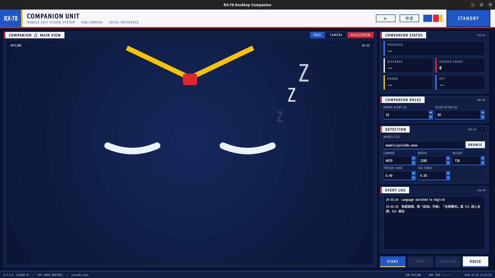

# RX-78 AI Desktop VISION

[简体中文](README.zh-CN.md) | English

A local Linux desktop companion built with a USB camera, YOLOv8, and PySide6. It detects people, phones, cats, dogs, and fire, then drives an animated RX-78-inspired face, gaze tracking, alerts, and offline voice interaction.

The application runs entirely on the device. It supports ONNX Runtime on x86_64/aarch64 CPUs and RKNN acceleration on the RK3576 NPU.



## Features

- Person presence state machine with arrival, departure, sleep, and distance awareness.
- Animated face with seven expressions, blinking, smooth transitions, and gaze tracking.
- Phone-use reminders that reject implausible or fire-overlapping detections.
- Cat and dog recognition with companion events.
- Optional fire detection with temporal confirmation and static/color false-positive filters.
- Offline Chinese/English announcements using pre-generated audio.
- Offline SenseVoice commands for capture, language, mute, and fullscreen controls.
- Chinese/English UI and a fullscreen robot display mode.
- Automatic RK3576 NPU selection with CPU fallback.

## Supported Platforms

| Platform | Inference backend | Status |
|---|---|---|
| Debian/Ubuntu x86_64 | ONNX Runtime CPU | Supported |
| Debian/Ubuntu aarch64 | ONNX Runtime CPU | Supported |
| Quectel PI M2 / RK3576 | RKNN NPU, with CPU fallback | Verified |

The reference board is a Quectel PI M2 with 4 GB RAM, Debian 13, Python 3.13, GNOME Wayland, and a 1280×800 DSI display.

## Quick Start

Place the required models under `models/` first. See [DEPLOYMENT.md](DEPLOYMENT.md) for the complete model list, purpose of each model, RK3576 deployment, and troubleshooting.

```bash
chmod +x setup_env.sh run_gui.sh
./setup_env.sh                 # Install dependencies, validate models, and run tests
./run_gui.sh                   # Windowed mode
./run_gui.sh --robot           # Fullscreen robot mode
```

Useful setup options:

```bash
./setup_env.sh --skip-system   # Skip apt packages
./setup_env.sh --china-mirror  # Use the Aliyun PyPI mirror
./setup_env.sh --check-only    # Validate the existing environment only
```

Other launch options:

```bash
./run_gui.sh --lang zh
./run_gui.sh --lang en
```

## Models

All runtime models belong in `models/`. Paths are configured in `config.json`.

| Path | Purpose |
|---|---|
| `models/yolov8n.onnx` | Required CPU model for person, phone, cat, and dog detection |
| `models/yolov8n_rk3576_fp16.rknn` | RK3576 NPU version of the main detector |
| `models/fire_yolov8n.onnx` | CPU fire detector, required when fire detection is enabled |
| `models/fire_rk3576_fp16.rknn` | RK3576 NPU fire detector |
| `models/sherpa-onnx-sense-voice-zh-en-ja-ko-yue-2024-07-17/` | Optional offline speech-recognition model directory |

PyTorch `.pt` files and training artifacts are not used at runtime. Refer to [DEPLOYMENT.md](DEPLOYMENT.md#2-模型目录文件及作用) for exact filenames and responsibilities.

## Controls

| Control | Action |
|---|---|
| Start / Stop | Start or stop camera inference |
| Capture | Save the annotated frame under `captures/` |
| Face / Camera | Switch the main view |
| EN / 中文 | Change the UI language and save the preference |
| Speaker button | Enable or mute announcements |
| Microphone button | Record and execute one offline voice command |
| `F11` or double-click the face | Enter or leave fullscreen mode |
| `Esc` | Leave fullscreen mode |

## Configuration

Runtime settings are stored in `config.json`. The most important fields are:

| Field | Description |
|---|---|
| `backend` | `auto`, `npu`, or `cpu`; `auto` prefers RKNN when available |
| `model` / `rknn_model` | Main ONNX and RKNN detector paths |
| `camera` | `auto`, a numeric index, or a `/dev/video*` path |
| `fire_enabled` | Enable the optional fire detector |
| `fire_model` / `fire_rknn_model` | Fire detector paths |
| `asr_model_dir` | SenseVoice model directory |
| `voice_enabled` | Enable offline announcement playback |
| `default_view` | `face` or `camera` |
| `companion` | Presence, phone, pet, fire, and gaze behavior thresholds |

Detection settings are locked while the camera is running. Language, voice, reminder timing, and sleep timing can be changed at runtime.

## Development

```bash
source .venv/bin/activate
python -m unittest discover -s tests -v
PYTHONPATH=src QT_QPA_PLATFORM=offscreen \
  python -m usb_person_detector.entrypoints.env_check
```

The test suite contains 113 tests and does not require a camera, microphone, or model inference.

Project layout:

```text
src/usb_person_detector/
├── entrypoints/    # GUI and environment check
├── core/           # Companion state machine and translations
├── vision/         # ONNX/RKNN inference and camera handling
├── audio/          # Announcements and offline voice commands
└── ui/             # PySide6 face widget and theme
```

## Documentation

- [Environment deployment and model guide](DEPLOYMENT.md)

## Notes

- PySide6 Essentials is pinned to `6.8.3`; do not upgrade it without regression testing.
- RKNN conversion is performed on an x86 host using `tools/convert_rknn.py` and a separate `.venv-rknn` environment.
- The RK3576 runtime calls the board-provided `/usr/lib/librknnrt.so` directly and does not require `rknn-toolkit-lite2`.

## Technical support and contributions

If you encounter any problems during use, please submit a technical inquiry on the [Quectel official forum](https://forums.quectel.com/c/quectel-pi/80). The Quectel technical support team will respond promptly.
