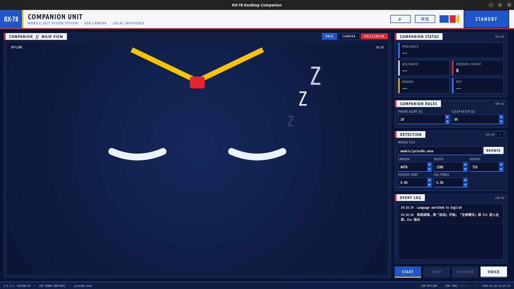

# AI桌面视觉系统

简体中文 | [English](README.md)

基于 USB 摄像头、YOLOv8 和 PySide6 的 Linux 本地桌面陪伴应用。程序可检测人、手机、猫、狗和明火，并驱动 RX-78 风格的动态表情、目光跟随、事件提醒和离线语音交互。

应用完全在本机运行，支持 x86_64/aarch64 CPU 上的 ONNX Runtime，以及 RK3576 NPU 上的 RKNN 加速。



## 主要功能

- 有人/无人状态机：到达、离开、休眠和距离感知。
- 动态表情脸：7 种表情、自动眨眼、平滑过渡和目光跟随。
- 玩手机提醒：过滤几何异常以及与明火框重叠的误检。
- 猫狗识别和宠物陪伴事件。
- 可选明火检测：包含时序确认、静止元素过滤和颜色校验。
- 使用预生成音频进行离线中英文语音播报。
- 使用 SenseVoice 离线识别拍照、语言切换、静音和全屏等指令。
- 中英文界面和全屏机器人显示模式。
- RK3576 NPU 自动选择，加载失败时回退到 CPU。

## 支持平台

| 平台 | 推理后端 | 状态 |
|---|---|---|
| Debian/Ubuntu x86_64 | ONNX Runtime CPU | 支持 |
| Debian/Ubuntu aarch64 | ONNX Runtime CPU | 支持 |
| Quectel PI M2 / RK3576 | RKNN NPU，CPU 回退 | 已验证 |

参考开发板为 Quectel PI M2（4 GB）、Debian 13、Python 3.13、GNOME Wayland 和 1280×800 DSI 屏幕。

## 快速开始

先将运行所需模型放入 `models/`。完整模型清单、每个模型的用途、RK3576 部署和故障排查见 [DEPLOYMENT.md](DEPLOYMENT.md)。

```bash
chmod +x setup_env.sh run_gui.sh
./setup_env.sh                 # 安装依赖、检查模型并运行测试
./run_gui.sh                   # 普通窗口模式
./run_gui.sh --robot           # 全屏机器人模式
```

部署脚本常用选项：

```bash
./setup_env.sh --skip-system   # 跳过 apt 系统包
./setup_env.sh --china-mirror  # 使用阿里云 PyPI 镜像
./setup_env.sh --check-only    # 只检查现有环境
```

其他启动方式：

```bash
./run_gui.sh --lang zh
./run_gui.sh --lang en
```

## 模型

运行时模型统一放在 `models/`，具体路径由 `config.json` 配置。

| 路径 | 作用 |
|---|---|
| `models/yolov8n.onnx` | 必需的 CPU 主模型，检测人、手机、猫和狗 |
| `models/yolov8n_rk3576_fp16.rknn` | 主检测模型的 RK3576 NPU 版本 |
| `models/fire_yolov8n.onnx` | CPU 明火检测模型；开启明火检测时必需 |
| `models/fire_rk3576_fp16.rknn` | 明火模型的 RK3576 NPU 版本 |
| `models/sherpa-onnx-sense-voice-zh-en-ja-ko-yue-2024-07-17/` | 可选的离线语音识别模型目录 |

PyTorch `.pt` 权重和训练产物不参与运行。准确文件名和详细用途见 [DEPLOYMENT.md](DEPLOYMENT.md#2-模型目录文件及作用)。

## 界面操作

| 操作 | 作用 |
|---|---|
| 启动 / 停止 | 启动或停止摄像头推理 |
| 拍照 | 将带标注画面保存到 `captures/` |
| 表情 / 画面 | 切换主视图 |
| EN / 中文 | 切换界面语言并保存偏好 |
| 扬声器按钮 | 开启或关闭语音播报 |
| 麦克风按钮 | 录制并执行一次离线语音指令 |
| `F11` 或双击表情脸 | 进入或退出全屏模式 |
| `Esc` | 退出全屏模式 |

## 配置

运行配置保存在 `config.json`，主要字段如下：

| 字段 | 说明 |
|---|---|
| `backend` | `auto`、`npu` 或 `cpu`；`auto` 优先使用 RKNN |
| `model` / `rknn_model` | 主检测 ONNX 和 RKNN 模型路径 |
| `camera` | `auto`、数字编号或 `/dev/video*` 路径 |
| `fire_enabled` | 是否启用明火检测 |
| `fire_model` / `fire_rknn_model` | 明火模型路径 |
| `asr_model_dir` | SenseVoice 模型目录 |
| `voice_enabled` | 是否启用离线语音播报 |
| `default_view` | `face` 或 `camera` |
| `companion` | 人员、手机、宠物、明火和目光行为阈值 |

摄像头运行期间检测参数会被锁定；语言、语音、提醒时间和休眠时间可在运行中调整。

## 开发与测试

```bash
source .venv/bin/activate
python -m unittest discover -s tests -v
PYTHONPATH=src QT_QPA_PLATFORM=offscreen \
  python -m usb_person_detector.entrypoints.env_check
```

项目包含 113 个测试，不需要摄像头、麦克风或实际模型推理。

代码结构：

```text
src/usb_person_detector/
├── entrypoints/    # GUI 和环境自检
├── core/           # 陪伴状态机和多语言文案
├── vision/         # ONNX/RKNN 推理和摄像头处理
├── audio/          # 语音播报和离线语音指令
└── ui/             # PySide6 表情控件和主题
```

## 相关文档

- [环境部署与模型说明](DEPLOYMENT.md)

## 注意事项

- PySide6 Essentials 固定为 `6.8.3`，不要在未回归测试的情况下升级。
- RKNN 转换应在 x86 主机上使用 `tools/convert_rknn.py` 和独立的 `.venv-rknn` 环境完成。
- RK3576 运行时直接调用开发板提供的 `/usr/lib/librknnrt.so`，不需要安装 `rknn-toolkit-lite2`。

## 技术支持与贡献

如在使用过程中遇到问题，欢迎在[移远官方论坛](https://forumschinese.quectel.com/c/quectel-pi/58)提交技术咨询，移远技术支持团队将及时为您解答。
